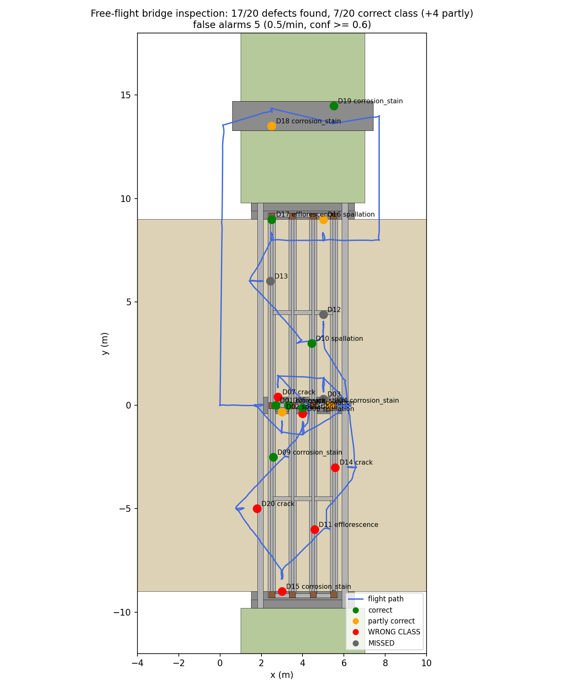
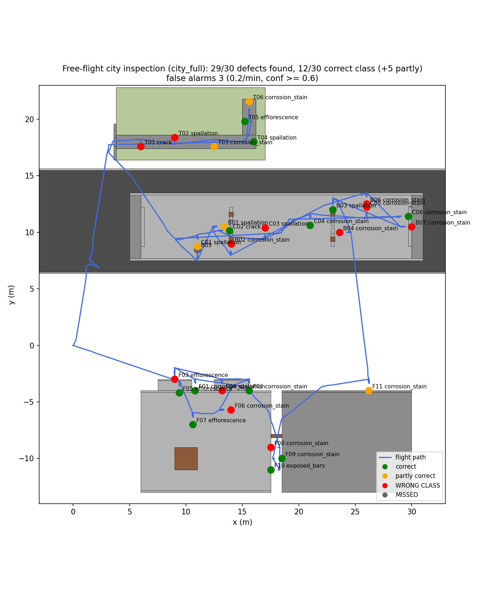
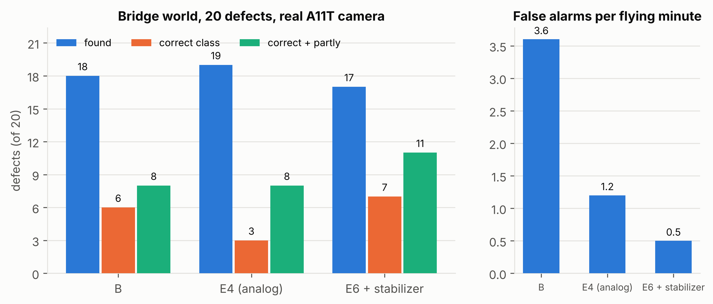
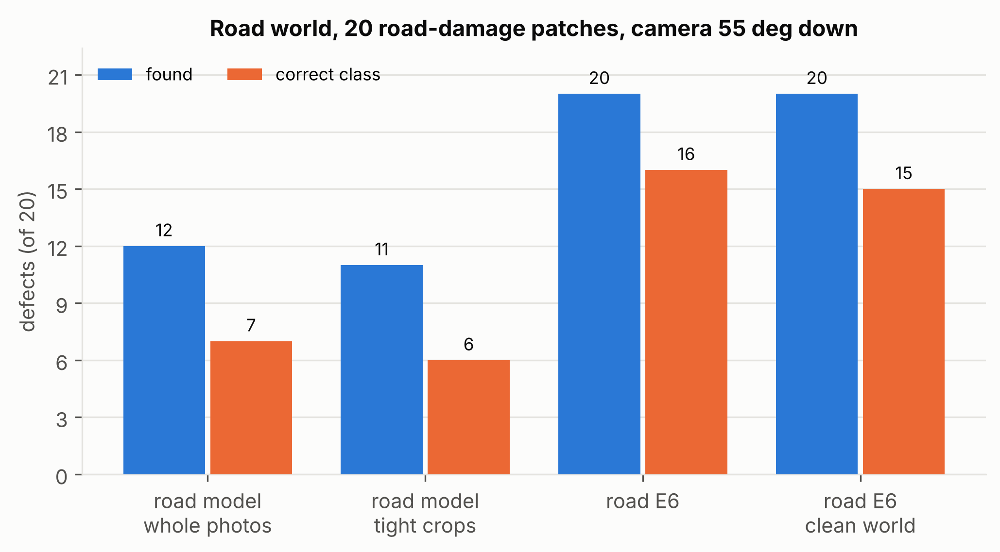
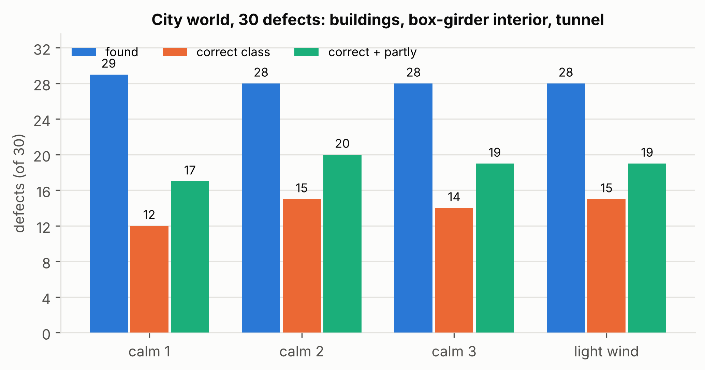
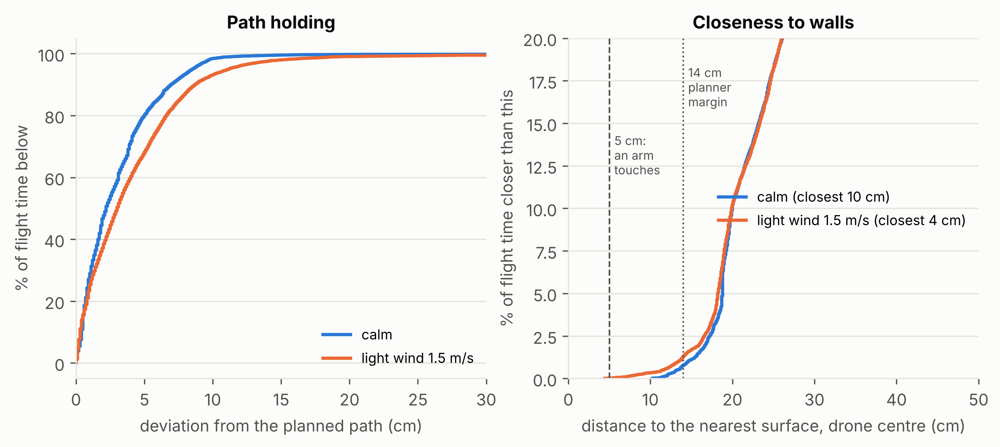
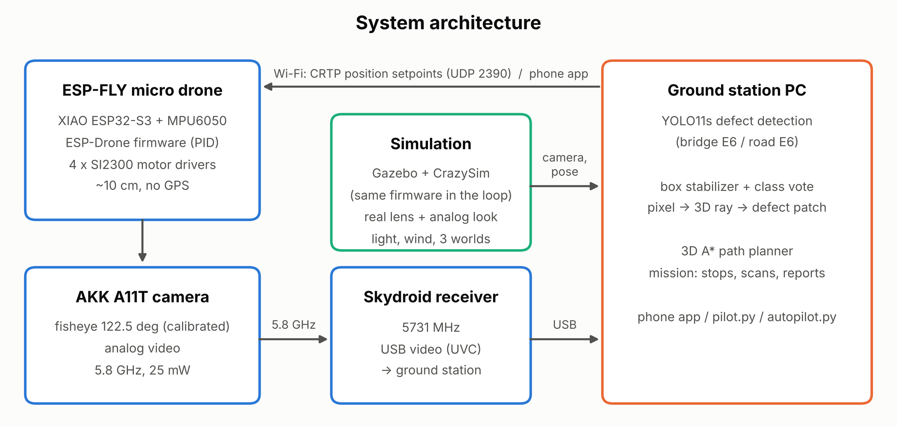

# ESP-FLY Inspection — a micro drone that finds defects in bridges, roads and buildings

Graduation project, AI specialization, College of Engineering, University of Buraimi (Oman).

A ~10 cm micro drone (ESP-FLY, Seeed XIAO ESP32-S3) carries a tiny analog FPV camera (AKK A11T,
5.8 GHz). The video goes to a PC, where a YOLO11 model finds and classifies defects live:
concrete defects on bridges and buildings (crack, spallation, efflorescence, exposed bars,
corrosion stain) and road damage (longitudinal, transverse and alligator cracks, potholes).
The drone flies the inspection **by itself** in a realistic Gazebo simulation: it plans
collision-free 3D paths through tight spaces (0.8 m hatches, 0.7 m manholes, 1 m alleys,
0.8 m tunnels), stops in front of every defect, scans it and writes a report.

The simulated camera is the **real** camera: its fisheye lens was calibrated from a video of a
checkerboard, and the analog radio picture (noise, blur, colour bleed) is reproduced, so the
models are tested on what the drone will really see.

| | |
|---|---|
|  |  |
| Bridge world — autonomous inspection report | City world — 221 m through buildings, a box girder and a tunnel |

## Results at a glance (simulation, real A11T lens + analog video)

| World | Defects | Found | Correct class | False alarms | Notes |
|---|---|---|---|---|---|
| Bridge (`bridge_full`) | 20 | 17/20 | 7 (+4 partly) | 0.5 / min | bridge model E6 + box stabilizer |
| Road (`road_full`) | 20 | **20/20** | **15/20** | **0** | road model E6, camera 55° down |
| City (`city_full`) | 30 | 28–29/30 | 12–15 (+4–5 partly) | 0.2–0.6 / min | every tight space flown, no crash |

* The drone **reliably finds and locates** defects (85–100 %). The defect **type** is right
  40–75 % of the time: the analog video blurs the fine texture that separates the classes
  (with clean digital video a bridge model gets ~55 % exactly right, ~70 % with partly right).
* Navigation: mean deviation from the planned path **3.2 cm** in calm air, 4.4 cm in light wind.
* Wind: the 27 g drone flies the full mission in light wind (1.5 m/s); 3 m/s makes it sway
  ±0.4 m and crash; gusts to 5 m/s flip it at take-off. The safety margin to walls now grows
  with the wind (14 cm calm → 20 cm light).

Full numbers: [docs/06_results.md](docs/06_results.md).

| | |
|---|---|
|  |  |
|  |  |



## Repository layout

```
scripts/            flight + detection code (pilot, autopilot, planner, route, cameras, wind ...)
scripts/patches/    the upgrade patches in the order they were applied (already applied)
sim/worlds/         world generators (bridge, road, city) + each world's settings and maps
sim/camera/         A11T lens calibration and camera profile
sim/patches/        add the FPV camera to the CrazySim drone model
notebooks/          model training notebooks (bridge E4/E6, road model)
results/            every flight report, training curves, dataset examples, calibration images
models/             which trained models exist (the .pt files are in the GitHub release)
setup/              requirements.txt, shell aliases, install steps
docs/               full documentation (start with 01_setup.md)
```

## Documentation

1. [Setup](docs/01_setup.md) — Ubuntu, Python, Gazebo + CrazySim, aliases, folders
2. [Hardware](docs/02_hardware.md) — the ESP-FLY drone, A11T camera, receiver, plans for GPS
3. [Camera calibration](docs/03_camera_calibration.md) — measuring the real fisheye lens
4. [Models and datasets](docs/04_models.md) — bridge models B → E6, road model, drone-view training
5. [Simulation](docs/05_simulation.md) — worlds, pilot / autopilot, light, wind, safety margin
6. [Results](docs/06_results.md) — every experiment with its numbers and log folder
7. [Logbook](docs/07_logbook.md) — what was done, in order
8. [Report guide](docs/08_report_guide.md) — which file backs each section of report Chapters 3–5

## Quick start (simulation)

```bash
simworld city_full --light noon --wind calm     # choose world, light, wind
simreset; simfull                               # start Gazebo + the drone firmware
autopilot                                       # 2nd terminal, press T: autonomous inspection
pilot                                           # ... or fly it yourself (Xbox pad / keyboard)
```

## Credits and licenses

Code: MIT (see LICENSE). Simulator: [CrazySim](https://github.com/gtfactslab/CrazySim) on
Gazebo Sim. Datasets (not included, see docs/04_models.md for sources and licenses): dacl10k,
CODEBRIM, RDD2022. Textures: Poly Haven (CC0). 3D models: Gazebo Fuel (OpenRobotics).
YOLO: Ultralytics YOLO11.
