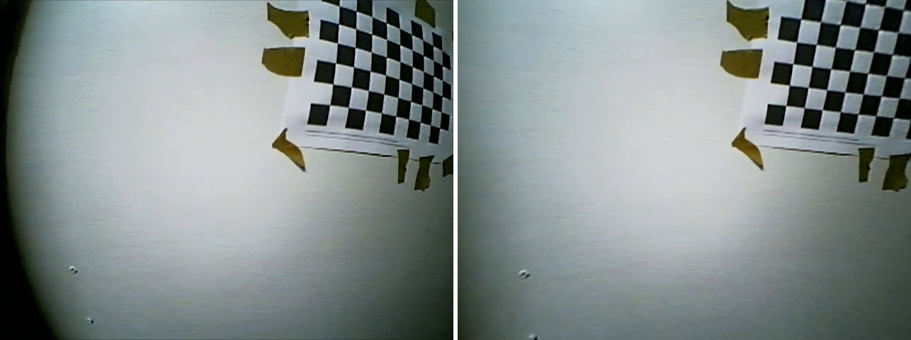
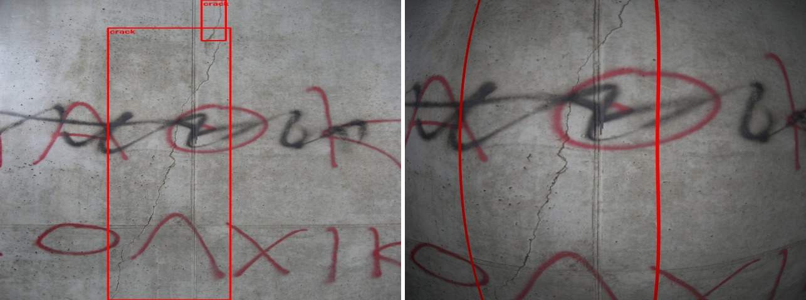

# 3. Calibrating the real A11T lens

Why: the A11T has a strong fisheye lens. A perfect 90° simulator camera would make the
models look better than they are, and the 3D maths (which pixel looks at which point of the
bridge) would be wrong. So the real lens was measured.

## How

1. A checkerboard was printed and taped flat on a wall.
2. The A11T video was recorded through the receiver while moving the camera slowly in front of
   the board: centre, corners, edges, tilted left/right/up/down, near and far.
3. 60 sharp frames with the full board were picked and OpenCV's **fisheye (Kannala-Brandt)**
   calibration was run.

## Result (`sim/camera/a11t_calib.json`)

| | |
|---|---|
| image | 640 × 480 |
| RMS reprojection error | **0.83 px** |
| field of view | **122.5° horizontal, 97.6° vertical** |
| K | fx 206.3, fy 208.1, cx 324.9, cy 231.9 |
| D (k1..k4) | 0.5514, 0.1831, −0.5542, 0.2381 |

## Using it in the simulator (`scripts/fisheye_cam.py`, `scripts/camprofile.py`)

* Gazebo renders a wide pinhole picture (960 × 720 at 136°, enough to cover the fisheye
  corners); `fisheye_cam.Lens` bends it into the real A11T picture with a lookup table
  (exact inverse of the Kannala-Brandt model; OpenCV's own undistortPoints was 44 px off in the
  corners), and adds the measured dark corners (vignetting).
* `analog_cam.py` then adds the analog radio look (blur, chroma bleed, noise, interference
  lines, JPEG) in 3 strengths: good / typical / bad.
* `pilot.py` / `autopilot.py` use the same lens model for pixel → 3D ray, so detections are
  matched to the right defect.

